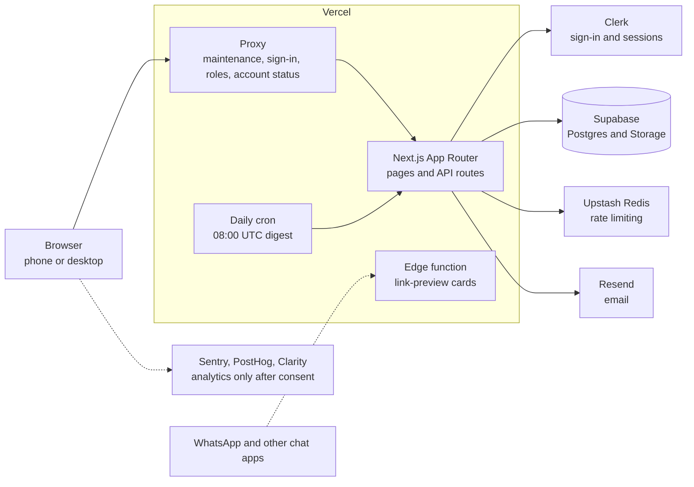
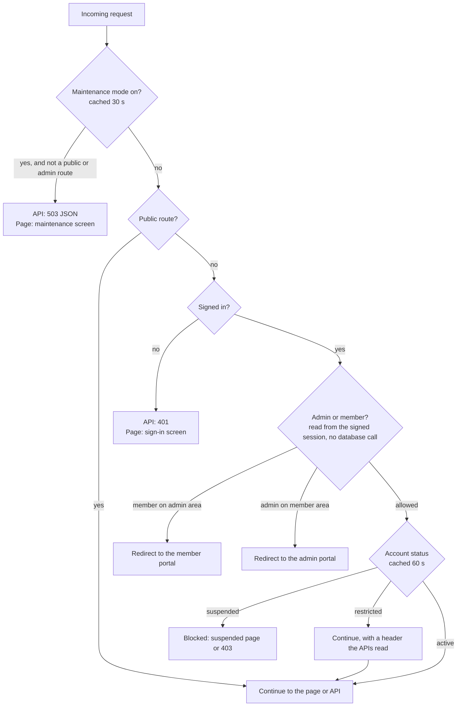

# Architecture

ReWeave is a single **Next.js 16** application (App Router) hosted on **Vercel**. The same codebase serves the pages and the API. It delegates sign-in to **Clerk**, stores data and files in **Supabase**, sends email through **Resend**, and limits abuse with **Upstash Redis**.

## How a request flows

Every request passes through one gate, the Next.js 16 **Proxy**, before it reaches a page or an API route.

## Key design decisions

### Admin status lives in the identity provider
Whether someone is an admin is stored as signed metadata on their Clerk account, which can only be set on the server side. It travels inside the session token, so deciding "admin or member?" for every request costs **no database call** and cannot be forged from the browser. Admin and member areas are exclusive.

### The server is the gatekeeper, the database is the safety net
API routes use a privileged database key and **check permissions themselves**: who is calling, what role they have, and whether they own the record. Row-level security is switched on for all 16 tables as a backstop against direct use of the public key, but the app does not rely on it. The browser never holds a database key.

### Members are created on first use
There are no webhooks. The first time a signed-in person loads a portal page, a member record is created (and a welcome email sent). The profile is cached for five minutes and is invalidated immediately when the member edits it, so a just-saved WhatsApp number takes effect right away. Anything that is not the main action (notifications, emails, "last seen" timestamps) never blocks it.

### Failing open, on purpose
If the rate limiter or the maintenance-mode lookup is unreachable, requests are allowed instead of taking the whole platform down.

## Features that cut across the system

### Notifications
Events (a reply, a contact request, an acceptance or decline, a verification decision, an announcement) create an in-app notification, shown in a bell that refreshes every 60 seconds. Email is sent for the welcome message, verification decisions and announcements. For members who have been away, a **daily digest** (a Vercel cron at 08:00 UTC) emails one summary of anything unread. The cron endpoint refuses requests without a secret.

### Link previews
When an order or listing is shared, chat apps fetch the public page and read its tags. The title, description and a **1200×630 image generated on the fly** (an edge function) make a clean preview card. The public pages are viewable without signing in and never include contact details.

### Verification and files
Members upload ID documents; admins approve or reject; approved members get a Verified badge. Uploads are checked for **type, size and the file's real leading bytes**, so a renamed file is refused. ID documents live in a **private bucket**, and admins open them only through **one-hour signed links**.

### Rate limiting
Three sliding-window limits, per client IP for public endpoints and per user for signed-in ones:

| Tier | Limit |
|---|---|
| Public (preview cards, prices, public config) | 60 requests per minute per IP |
| Signed-in members | 120 requests per minute per user |
| Admin | 60 requests per minute per user |

## Security measures

| Area | Measure |
|---|---|
| Sign-in | Handled by Clerk: mandatory email verification at sign-up, passwords never stored by ReWeave |
| Authorization | Role and ownership checked on every write; role chosen at sign-up cannot be changed |
| Input | Schema validation on the core write endpoints; search text stripped of query-syntax characters |
| Output | User text is HTML-escaped in emails and dialogs |
| Uploads | Type and size limits, magic-byte check, images compressed in the browser |
| Documents | Private bucket, one-hour signed links |
| Headers | Content security policy, HSTS (two years), frame denial, no content sniffing, strict referrer policy |
| Privacy | Analytics and session recording start only after the visitor accepts cookies |
| Secrets | Never in the repository; configured on the host |

## Hosting and delivery

- **Vercel** builds and deploys every push to `main`.
- **CI** (GitHub Actions) runs lint, the unit tests and a production build on every push and pull request.
- The live demo uses Clerk **development-mode** keys, so a production launch would need a domain and production keys.

## Size

About 25,000 lines of JavaScript in roughly 150 files: 40 pages, 43 API routes, 16 database tables and 3 storage buckets (early November 2026).

Related: [data model](data-model.md), [user journeys](user-journeys.md), [engineering notes](engineering-notes.md).
