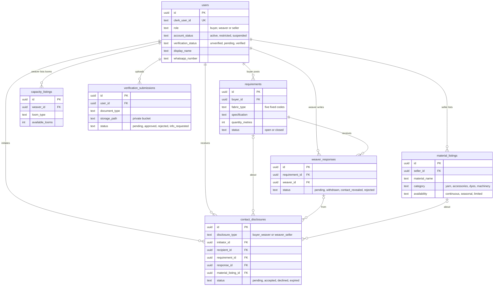
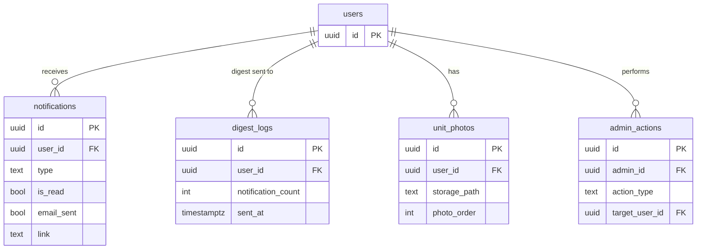
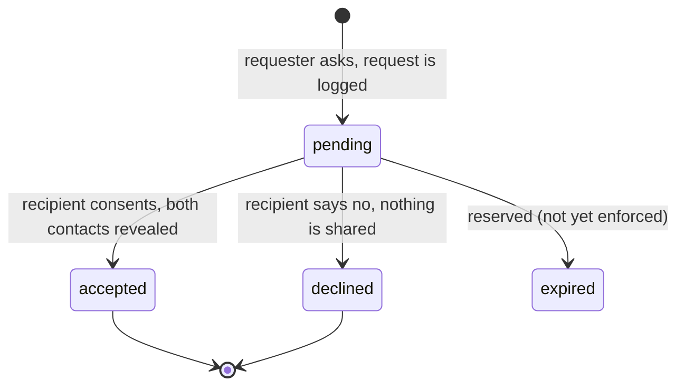
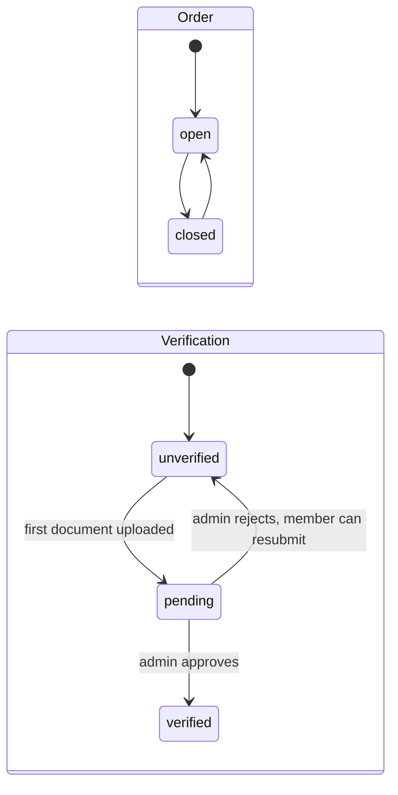

# Data model

ReWeave stores everything in a Supabase project: **PostgreSQL** for data and **Storage** for files. There are **16 tables**, all with row-level security switched on, and **3 storage buckets**.

These diagrams were generated from the project's migrations: every migration file was applied, in order, to an empty database, and the tables, columns and relationships were read back. Only the key columns are shown.

## Core: people, orders and consent

## Supporting tables attached to a member

## Standalone tables

| Table | Purpose |
|---|---|
| `drafts` | Saved, unfinished forms (one per member and form type) |
| `yarn_prices` | Entries for the yarn-price ticker, maintained by admins |
| `system_config` | Platform switches such as maintenance mode and whether registration is open |
| `broadcasts` | History of announcements sent by admins |
| `platform_alerts` | Alerts shown on the admin threat monitor |

## The core table: `contact_disclosures`

Every contact request, in both directions, is a row here. It is the platform's audit ledger, and an admin can read all of it.

- **Direction is fixed.** `buyer_weaver` means a buyer asked a weaver. `weaver_seller` means a weaver asked a seller. Sellers never initiate and buyers never receive.
- **It records what the request was about**: the order, the reply, or the material listing.
- **It has a lifecycle**, shown below. Timestamps record when it was requested and answered, and a default expiry date is stored.

## Other lifecycles

- **Reply:** `pending`, then `contact_revealed` when the buyer's request is accepted, or `rejected` when it is declined.
- **Account:** `active`, `restricted` (can browse, but cannot post, reply, request or add a material) or `suspended` (blocked everywhere). Admins set it.

## Rules the database enforces

| Rule | Why it matters |
|---|---|
| One reply per weaver per order | No duplicate replies |
| One contact request per requester, recipient and order | No repeated asking |
| For weaver to seller: one *active* (pending or accepted) request per weaver, seller and listing | Stops request spam, but allows asking again after a decline |
| Fixed allowed values for roles, statuses, fabric types, categories and document types | Bad values are rejected at the source |

## Files

| Bucket | Visibility | Contents |
|---|---|---|
| `profile-photos` | public | Profile photos, cover and gallery photos |
| `material-images` | public | Supplier listing photos |
| `verification-docs` | **private** | ID documents. Only reachable through one-hour signed links an admin opens |

Related reading: [architecture](architecture.md), [user journeys](user-journeys.md) and the [screens gallery](screens.md).
