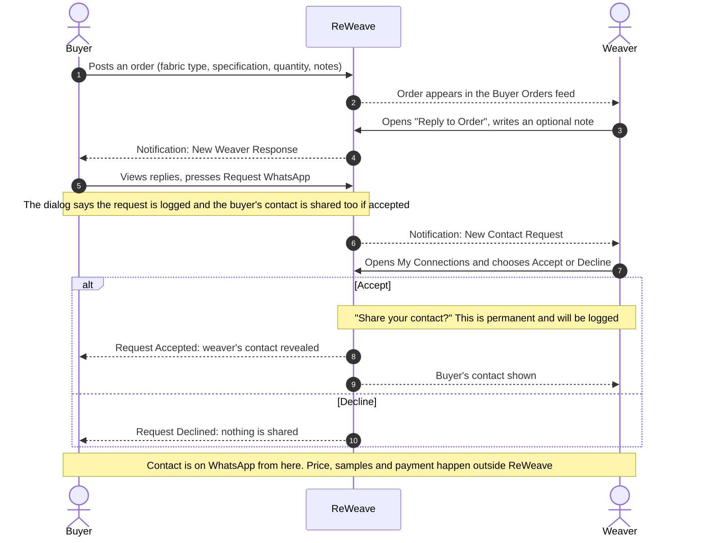
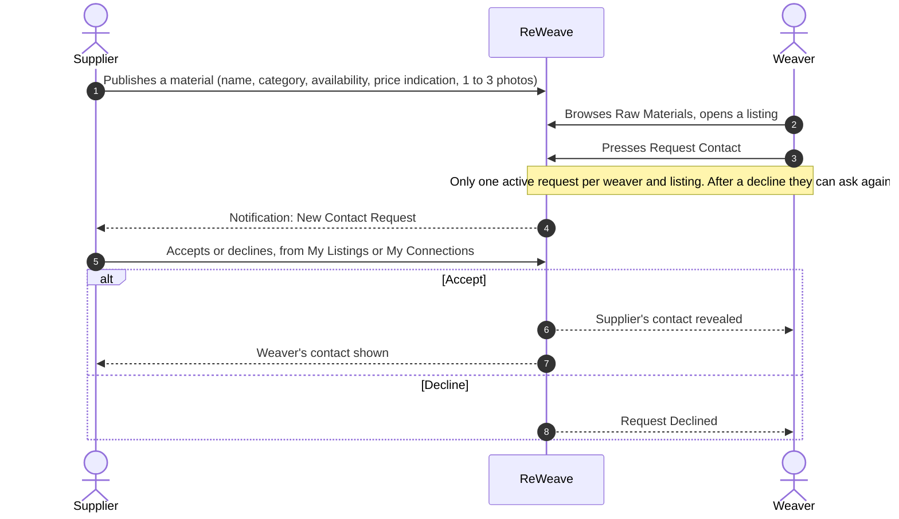
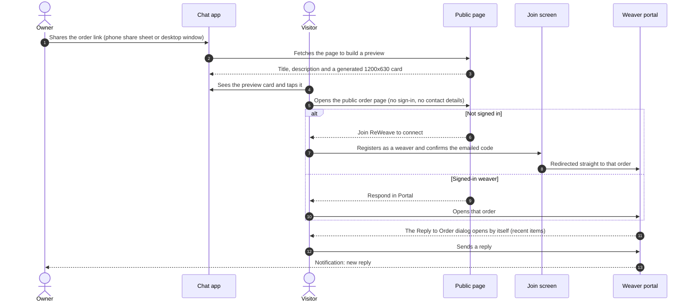
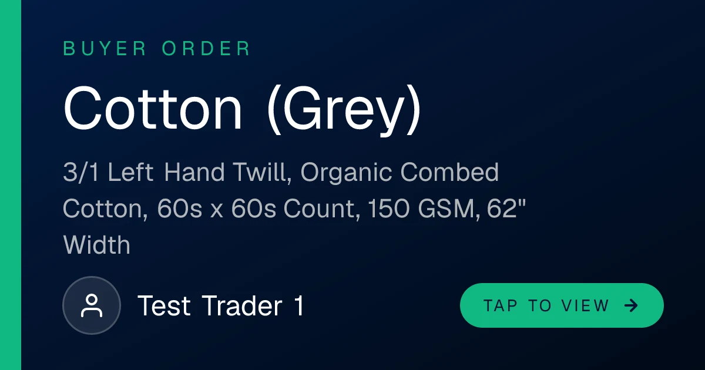
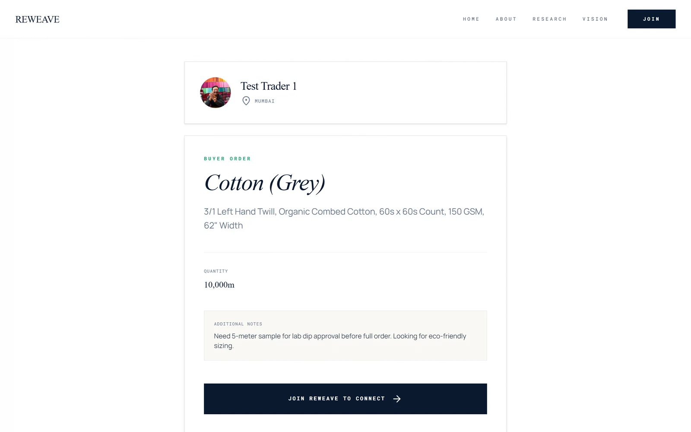
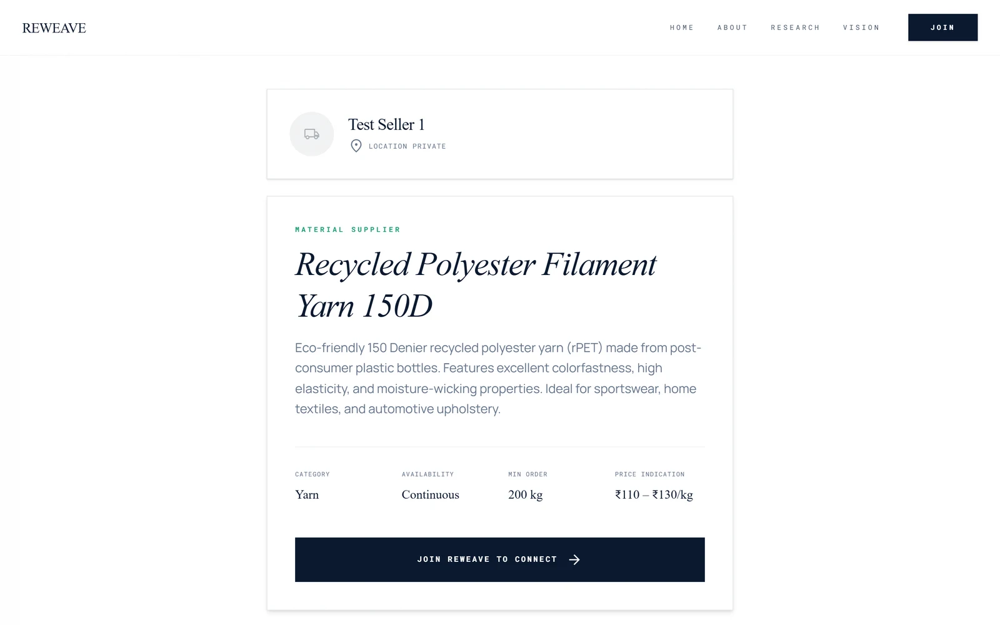
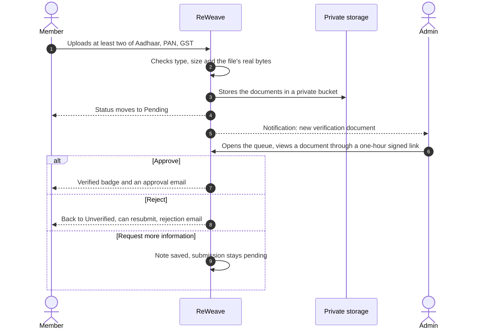

# User journeys

Four journeys cover the whole product. Each diagram follows what the screens actually do.

## 1. Buyer to weaver: the main flow

Points worth noticing:
- **A weaver needs a WhatsApp number or group link on their profile before they can accept.** Otherwise the server asks them to add one.
- **One reply per order.** A second attempt is refused, and replies to closed orders are refused.
- The order card shows an **unread badge** ("2 New") that stays in sync across the buyer's devices.

## 2. Weaver to supplier

Sellers never start a conversation and buyers never receive requests. Direction is fixed so nobody can be cold-contacted.

## 3. A shared link, from WhatsApp to a reply

What each visitor sees on the public page:

| Visitor | Button |
|---|---|
| Not signed in | Join ReWeave to connect |
| Signed in as the owner | Manage in Dashboard |
| Signed in as a weaver | Respond in Portal |
| Signed in as another buyer or a supplier | Go to My Dashboard |

A closed order shows an "Order Closed" overlay, and an inactive listing shows "Listing Unavailable". The public pages never show WhatsApp numbers, email addresses, replies, or who contacted whom.

<table>
<tr>
<td width="33%"> The preview card in the chat.</td>
<td width="33%"> The public order page.</td>
<td width="33%"> The public listing page.</td>
</tr>
</table>

## 4. Getting verified

Being verified adds a green tick on profile cards, replies and public pages, and it powers the weaver feed's **Verified buyers only** filter. It does not unlock features. Anyone can register and use the platform, and verification is about trust.

Related: [architecture](architecture.md), [data model](data-model.md) and the [screens gallery](screens.md).
